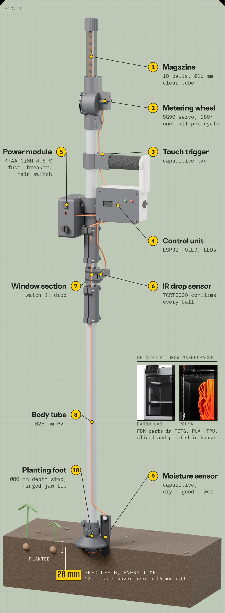
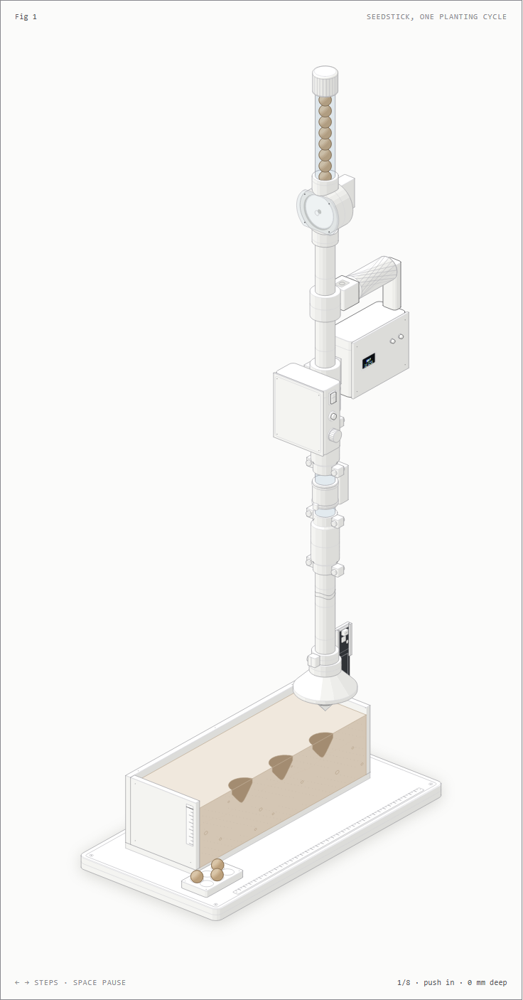
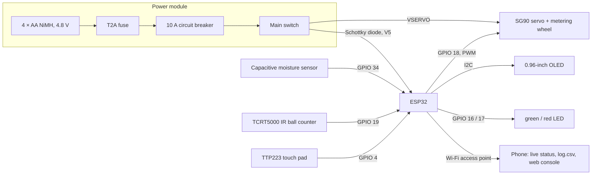
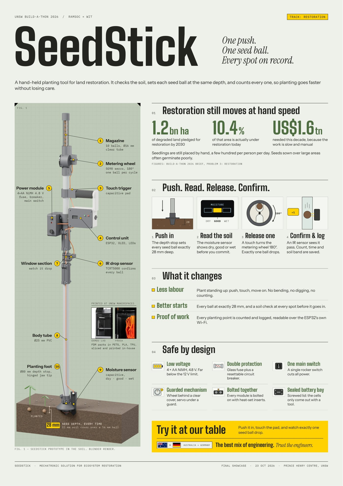

# SeedStick

**One push. One seed ball. Every spot on record.**

[](docs/build-a-thon.md)
[](docs/build-a-thon.md#result)
[](docs/build-a-thon.md#the-brief)

[](LICENSE)
[](LICENSE-hardware)

SeedStick is a hand-held planting tool for land restoration. It checks the soil, sets each seed ball at the same
depth and counts every one, so planting goes faster without losing care.

🏆 **1st place in the Preliminary Round at the UNSW Build-a-thon 2026**

🏆 **1st place Overall at the UNSW Build-a-thon 2026** (RAMSoc × WIT with UNSW Founders, track: restoration), out of 60 teams
and about 300 participants.<br>
💚 **People's Choice Award**: voted the favourite project by the visitors and participants of the final showcase at
the Prince Henry Centre, UNSW, on 23 October 2026.

<p align="center"></p>

<p align="center"><em>The SeedStick prototype: magazine, metering wheel, handle with control unit, power module,
sight window with IR sensor and the planting foot with its moisture sensor.</em></p>

## Contents

- [Highlights](#highlights)
- [The challenge](#the-challenge-restoration-still-moves-at-hand-speed)
- [Our solution](#our-solution-push-read-release-confirm)
- [System overview](#system-overview)
- [Specifications](#specifications)
- [Build your own](#build-your-own)
- [Repository structure](#repository-structure)
- [Design decisions](#design-decisions)
- [Poster](#poster)
- [Team and acknowledgements](#team-and-acknowledgements)
- [Licence](#licence)

## Highlights

- **One seed ball per tap**: a servo-driven metering wheel releases exactly one ball from a magazine of ten.
- **Same depth every time**: a depth collar and a self-closing jaw tip set every ball 28 mm deep.
- **Soil check before planting**: a capacitive moisture sensor on the foot shows dry, good or wet.
- **Every ball confirmed and logged**: an infrared sensor counts the falling ball; the log is read on a phone over
  the stick's own Wi-Fi.
- **Safe and repairable**: 4.8 V NiMH, fuse plus circuit breaker, one main switch; 24 printed parts on standard
  PVC and polycarbonate tubes, screwed together with heat-set inserts and nuts.
- **Fully documented**: STL files, wiring, firmware, bill of materials, assembly guide and an interactive figure.

## The challenge: restoration still moves at hand speed

The Build-a-thon brief set three environmental problems: monitoring, repurposing and restoration. We chose
**problem 3, restoration**: returning degraded ecosystems to life by replanting and rebuilding habitat.

| | |
|---|---|
| **1.2 billion ha** | of degraded land that countries have pledged to restore by 2030 |
| **10.4 %** | of that area is actually under restoration today |
| **US$ 1.6 trillion** | needed this decade, according to the UN, because the work is slow, manual and expensive |

Up to 40 % of the world's land is already degraded, and between 2015 and 2019 at least 100 million hectares of
healthy land were degraded every year. Restoration is barely mechanised: seedlings are placed by hand, a few hundred
per person per day, and seeds sown over large areas often germinate poorly. A solution had to reduce the labour of
restoration, reduce harmful by-products, rebuild ecosystem structure, or improve germination and survival.

_Figures: UNSW Build-a-thon 2026 brief, problem 3: restoration._ More about the event, its rules and the judging
criteria: [docs/build-a-thon.md](docs/build-a-thon.md).

## Our solution: push, read, release, confirm

SeedStick plants **seed balls** (seeds packed in clay and compost) standing up, one spot after the other:

1. **Push in.** The depth stop sets every seed ball at the same depth: 28 mm, that is 12 mm of soil over a 16 mm
   ball.
2. **Read the soil.** The capacitive moisture sensor on the foot shows dry, good or wet before you commit; a green
   LED means "plant here". (The main firmware shows the German labels TROCKEN, GEEIGNET, NASS.)
3. **Release one.** Lift the stick about 2 cm and tap the touch pad: a servo turns the metering wheel 180° and
   exactly one ball drops from the magazine. It pushes the two jaws at the tip open and lands in the hole.
4. **Confirm and log.** An infrared sensor sees the ball pass the window in the clear tube. Count, time, moisture
   and soil band are saved and can be read on a phone over the stick's own Wi-Fi.

| What it changes | |
|---|---|
| **Less labour** | Plant standing up: push, touch, move on. No bending, no digging, no counting. |
| **Better starts** | Every ball at the same depth, and a soil check at every spot before it goes in. |
| **Proof of work** | Every planting point is counted and logged. |

<a href="docs/index.html"></a>

### Interactive figure

[docs/index.html](docs/index.html) plays the whole planting cycle step by step: push in, read the moisture, lift,
tap, the wheel turns, the infrared sensor confirms the ball, the jaws open, count and log. Two close-ups show the foot
in the soil and the metering wheel in section. Use ← → to step and space to pause (dark version:
[docs/dark.html](docs/dark.html)).

More detail on the mechanism and the electronics: [docs/how-it-works.md](docs/how-it-works.md).

<br clear="right">

## System overview



The battery voltage is measured on GPIO 35 through a 100 k / 100 k divider. Pin map, breadboard plan and power
chain: [electronics/wiring.md](electronics/wiring.md). Firmware: [firmware/README.md](firmware/README.md).

## Specifications

| | |
|---|---|
| Length | 1.26 m |
| Planting depth | 28 mm to the bottom of the seed ball (depth collar Ø 80 mm, tip 30 mm deep) |
| Seed balls | Ø 15.5 ± 0.5 mm, magazine for about 10 balls |
| Dosing | SG90 servo, metering wheel with two pockets, one ball per 180° turn |
| Sensing | capacitive soil moisture sensor, TCRT5000 infrared ball counter, battery voltage |
| User interface | TTP223 touch pad, 0.96" OLED, green and red LED |
| Controller | ESP32 dev board on a breadboard inside the handle housing |
| Power | 4 × AA NiMH (4.8 V), T2A fuse, 10 A circuit breaker, main switch; peak about 1.2 A |
| Connectivity | Wi-Fi access point "SeedStick": live status, CSV log download, web console |
| Structure | 25 mm PVC conduit and a polycarbonate sight tube, joined by printed couplings and clamp sleeves |
| Printed parts | 24 device parts in PETG, PLA and TPU (about 565 g), plus a showcase stand and printable dummy balls |
| Cost | about AUD 53 of purchased parts plus filament, within the AUD 150 budget ([bill of materials](hardware/bom.md)) |

## Build your own

1. **Print** the parts: [hardware/print-settings.md](hardware/print-settings.md).
2. **Buy** the rest: [hardware/bom.md](hardware/bom.md).
3. **Wire** the electronics: [electronics/wiring.md](electronics/wiring.md).
4. **Upload** the firmware with the Arduino IDE: [firmware/README.md](firmware/README.md).
5. **Assemble** the stick from the foot upwards: [docs/assembly.md](docs/assembly.md).
6. **Calibrate** the metering wheel end positions and the moisture sensor (air and water), then plant.

> **Safety:** switch the main switch **off** before plugging in USB. Otherwise the battery pack can feed back into
> the computer's USB port.

## Repository structure

```
hardware/
  stl/device/        all printed parts of the stick (STL, ready to slice)
  stl/accessories/   showcase stand, printable dummy seed balls
  stl/calibration/   fit-test card, seed-ball mould and go/no-go gauge
  laser/             acrylic sight cover (DXF, 3 mm)
  print-settings.md  material, orientation and settings for every part
  bom.md, bom.xlsx   bill of materials with sources and prices
electronics/
  wiring.md          pin map, breadboard plan, power chain, safety rules
firmware/
  seedstick/         main firmware (ESP32, Arduino)
  tests/             six small test sketches, one per module
  README.md          upload, operation, serial and web commands
docs/
  index.html         interactive figure of the planting cycle (dark.html: dark version)
  build-a-thon.md    the event, the brief, the rules and the judging criteria
  how-it-works.md    mechanism and electronics explained
  design-decisions.md  engineering choices and lessons learned
  assembly.md        build order
  poster/            the A2 showcase poster (PDF)
  images/            render, figure, poster and photos of the bought parts
```

## Design decisions

A few of the choices behind SeedStick; the full story, including what went wrong, is in
[docs/design-decisions.md](docs/design-decisions.md).

- **Metering wheel instead of a gate:** two opposite pockets, one 180° turn per ball, so a dose is always exactly one
  ball, and the servo is switched off between doses.
- **Self-closing tip:** two jaws held shut by a soft O-ring keep soil out while pushing in; the falling ball opens
  them. Our first jaws let the ring slide off, so the final ones have a seat with a lip.
- **Off-the-shelf tubes, printed joints:** PVC conduit and a clear polycarbonate tube, joined by clamp sleeves sized
  for 100 N pull and 200 N push. Modules clamp on and can be moved or reprinted.
- **Safe power:** NiMH instead of LiPo, fuse plus breaker, and a diode so USB never powers the servo. After we
  damaged a laptop USB port, firmware 1.2 gained a Wi-Fi web console so set-up needs no cable.

## Poster

The A2 poster from the final showcase: [docs/poster/SeedStick_Poster_A2.pdf](docs/poster/SeedStick_Poster_A2.pdf)

<a href="docs/poster/SeedStick_Poster_A2.pdf"></a>

## Team and acknowledgements

SeedStick was designed, built and presented by our Australian–German team at the UNSW Build-a-thon 2026.

- [@NielsN5](https://github.com/NielsN5)
- Archie Kater ([@KateredDesign](https://github.com/KateredDesign))

Thanks to the organisers and mentors of **RAMSoc**, **WIT** and **UNSW Founders**, and to the **UNSW makerspaces**
for the printers, tools and parts that made a six-week build possible.

## Licence

- Firmware and code: [MIT](LICENSE)
- 3D models, laser file, documentation and images: [CC BY 4.0](LICENSE-hardware)
- Third-party components: [THIRD_PARTY.md](THIRD_PARTY.md)
